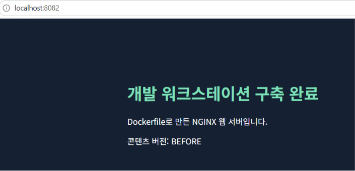
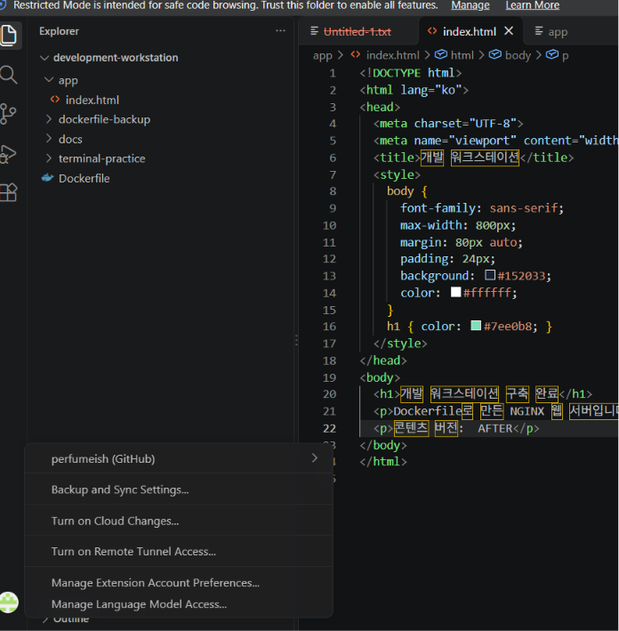
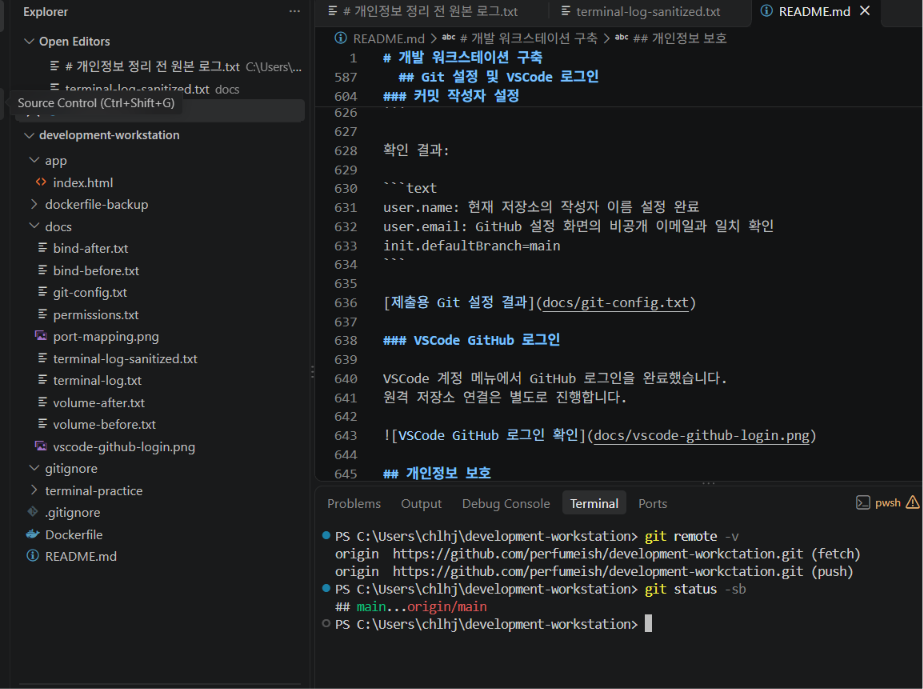

# 개발 워크스테이션 구축

## 프로젝트 개요

Windows 11에서 Docker, Git, VSCode를 이용해 개발 환경을 구성하고,
NGINX 기반 커스텀 웹 서버를 제작한 실습 프로젝트입니다.

터미널 파일 조작, Linux 권한 변경, Docker 운영,
포트 매핑, 바인드 마운트, 볼륨 영속성 및 GitHub 연동을 검증합니다.

## 실행 환경

| 항목 | 환경 및 버전 |
| --- | --- |
| OS | Windows 11 |
| 호스트 셸 | Windows PowerShell |
| 호스트 터미널 | Windows 터미널에서 PowerShell 사용 |
| 컨테이너 환경 | Docker Desktop, WSL2 기반 Linux 컨테이너 |
| 컨테이너 셸 | Ubuntu 24.04의 Bash |
| Docker Engine | 29.9.2 |
| Git | 2.56.0.windows.4 |
| VSCode | 1.145.3, x64 |

## 증거 파일

- [명령 및 출력 로그 — 이메일 마스킹본](docs/terminal-log-sanitized.txt)
- [파일·디렉터리 권한 변경 결과](docs/permissions.txt)
- [포트 매핑 접속 화면](docs/port-mapping.png)
- [바인드 마운트 변경 전](docs/bind-before.txt)
- [바인드 마운트 변경 후](docs/bind-after.txt)
- [볼륨: 컨테이너 삭제 전](docs/volume-before.txt)
- [볼륨: 컨테이너 삭제 후](docs/volume-after.txt)
- [Git 설정](docs/git-config.txt)
- [VSCode GitHub 로그인 화면](docs/vscode-github-login.png)

원본 터미널 로그는 개인정보 보호를 위해 Git 추적에서 제외했습니다.


## 수행 체크리스트

- [x] 터미널에서 현재 위치 및 숨김 파일 포함 목록 확인
- [x] 폴더 이동·생성, 빈 파일 생성, 파일 쓰기·읽기
- [x] 파일 복사·이름 변경·이동·삭제
- [x] Linux 파일 및 디렉터리 권한 변경 전·후 비교
- [x] Docker 버전 및 데몬 동작 확인
- [x] hello-world 실행
- [x] Ubuntu 컨테이너 진입 및 내부 명령 실행
- [x] 컨테이너 시작·종료 및 exec 동작 차이 확인
- [x] 이미지 다운로드 및 이미지·컨테이너 목록 확인
- [x] Dockerfile 기반 커스텀 이미지 빌드
- [x] 포트 매핑 및 브라우저 접속 확인
- [x] 컨테이너 로그 및 리소스 사용량 확인
- [x] 바인드 마운트 변경 반영 확인
- [x] 컨테이너 삭제 전·후 볼륨 데이터 유지 확인
- [x] Git 저장소 초기화 및 작성자·기본 브랜치 설정
- [x] VSCode에서 GitHub 로그인
- [x] 제출용 터미널 로그의 이메일 마스킹
- [x] GitHub 원격 저장소 생성 및 소스 업로드
- [x] VSCode와 원격 저장소 연동 증거 저장
- [x] 제출 전 문서·로그·스크린샷 최종 점검

## 터미널 조작 검증

PowerShell에서 다음 명령으로 실습했습니다.
명령과 전체 출력은 [터미널 로그](docs/terminal-log-sanitized.txt)에서 확인할 수 있습니다.

```powershell
Get-Location
Get-ChildItem -Force
New-Item -ItemType Directory -Path .\terminal-practice
Set-Location .\terminal-practice
New-Item -ItemType File -Path .\empty.txt
Set-Content -Path .\original.txt -Value "Hello, development workstation!" -Encoding utf8
Get-Content .\original.txt
Copy-Item -Path .\original.txt -Destination .\copy.txt
Rename-Item -Path .\copy.txt -NewName renamed.txt
New-Item -ItemType Directory -Path .\archive
Move-Item -Path .\renamed.txt -Destination .\archive\
Get-ChildItem .\archive -Name
Remove-Item -Path .\archive\renamed.txt
Test-Path .\archive\renamed.txt
Test-Path .\original.txt
```

핵심 결과:

```text
empty.txt의 Length: 0

파일 내용:
Hello, development workstation!

이동 후 archive 폴더의 파일:
renamed.txt

복사본 삭제 후 존재 여부:
False

원본 존재 여부:
True
```

### 절대 경로와 상대 경로

- 절대 경로는 현재 위치와 관계없이 전체 위치를 지정합니다.
  예: `C:\Users\<사용자>\development-workstation\app\index.html`
- 상대 경로는 현재 위치를 기준으로 지정합니다.
  과제 폴더에서 `.\app\index.html`은 위 파일을 가리킵니다.
- `.`은 현재 폴더, `..`은 상위 폴더를 뜻합니다.

## Linux 파일·디렉터리 권한 검증

Ubuntu 컨테이너 안에서 파일과 디렉터리의 권한을 변경했습니다.
[변경 전·후·복원 결과](docs/permissions.txt)

### 수행 명령

```bash
mkdir -p /tmp/permission-practice
cd /tmp/permission-practice
touch sample.txt
mkdir sample-dir

ls -ld sample.txt sample-dir

chmod 600 sample.txt
chmod 700 sample-dir
ls -ld sample.txt sample-dir

chmod 644 sample.txt
chmod 755 sample-dir
stat -c '%a %A %n' sample.txt sample-dir
```

### 검증 결과

```text
BEFORE
644:-rw-r--r--:sample.txt
755:drwxr-xr-x:sample-dir

AFTER
600:-rw-------:sample.txt
700:drwx------:sample-dir

RESTORED
644:-rw-r--r--:sample.txt
755:drwxr-xr-x:sample-dir
```

### 권한 해석

권한은 소유자, 그룹, 그 외 사용자 순서로 표시합니다.
각 자릿수는 읽기 r=4, 쓰기 w=2, 실행 x=1을 더한 값입니다.

| 권한 | 소유자 | 그룹 | 그 외 사용자 |
| --- | --- | --- | --- |
| 644 | 읽기·쓰기 | 읽기 | 읽기 |
| 600 | 읽기·쓰기 | 없음 | 없음 |
| 755 | 읽기·쓰기·실행 | 읽기·실행 | 읽기·실행 |
| 700 | 읽기·쓰기·실행 | 없음 | 없음 |

디렉터리에서 r은 목록 읽기, w는 항목 생성·삭제,
x는 디렉터리 진입 및 내부 항목 접근을 뜻합니다.
항목 생성·삭제에는 일반적으로 해당 디렉터리의 w와 x가 함께 필요합니다.

이번 실습은 root로 권한 표시 변경을 확인했습니다.
일반 사용자에 대한 실제 접근 차단 여부는 별도로 검증하지 않았습니다.

## Docker 설치 및 기본 동작 검증

### 버전 및 데몬 확인

```powershell
docker --version
docker info
```

핵심 출력:

```text
Docker version 29.9.2, build a82e528

Server Version: 29.9.2
Operating System: Docker Desktop
OSType: linux
Architecture: x86_64
Storage Driver: overlayfs
```

`docker info`의 Server 정보가 정상 출력되어
Docker CLI와 데몬의 연결을 확인했습니다.

### hello-world 실행

```powershell
docker run --rm hello-world
```

결과:

```text
Hello from Docker!
This message shows that your installation appears to be working correctly.
```

`--rm`은 실행 종료 후 해당 컨테이너를 자동 삭제합니다.

## Ubuntu 컨테이너 실행 및 종료 방식 비교

### 최초 실행 및 내부 명령

```powershell
docker run -it --name workstation-ubuntu ubuntu:24.04 bash
```

이미지가 로컬에 없어 자동으로 다운로드된 후 실행됐습니다.
컨테이너 내부에서 다음을 수행했습니다.

```bash
pwd
ls -la
echo "Hello from Ubuntu"
```

핵심 결과:

```text
/
Hello from Ubuntu
```

### 주 프로세스 종료

컨테이너의 주 프로세스인 Bash에서 실행했습니다.

```bash
exit
```

PowerShell에서 상태를 확인했습니다.

```powershell
docker ps -a --filter "name=workstation-ubuntu"
```

결과:

```text
STATUS: Exited (0)
```

### 재시작 및 exec 접속

```powershell
docker start workstation-ubuntu
docker exec -it workstation-ubuntu bash
```

추가로 실행된 Bash에서 다음을 수행했습니다.

```bash
echo "Connected with docker exec"
exit
```

PowerShell에서 다시 확인했습니다.

```powershell
docker ps --filter "name=workstation-ubuntu"
```

결과:

```text
STATUS: Up
```

주 프로세스를 종료하면 컨테이너가 중지됩니다.
`docker exec`로 추가한 셸만 종료하면 주 프로세스는 계속 실행됩니다.
`docker attach`는 새 셸을 만들지 않고 기존 주 프로세스에 연결하는 명령입니다.
이번 실습에서는 최초 실행 시 연결된 셸과 exec로 추가한 셸을 비교했습니다.

전체 명령 및 출력:
[터미널 로그](docs/terminal-log-sanitized.txt)

## Dockerfile 기반 커스텀 웹 서버

### 베이스 이미지와 커스텀 목적

공식 웹 서버 이미지인 `nginx:1.28-alpine`을 사용했습니다.
직접 만든 HTML을 기본 웹 페이지 대신 제공하도록 변경했습니다.

- `FROM`: NGINX가 설치된 기존 이미지를 재사용합니다.
- `COPY`: 직접 작성한 웹 페이지를 웹 루트에 복사합니다.
- `EXPOSE`: 컨테이너가 사용하는 포트 80을 문서화합니다.
  실제 호스트 포트 연결은 `docker run -p`로 설정합니다.

소스:
[Dockerfile](Dockerfile), [웹 페이지](app/index.html)

### Dockerfile

```dockerfile
FROM nginx:1.28-alpine
COPY app/ /usr/share/nginx/html/
EXPOSE 80
```

### 빌드 및 이미지 확인

```powershell
docker build -t workstation-web:1.0 .
docker images workstation-web
```

빌드 후 확인한 결과:

```text
IMAGE                 ID             DISK USAGE   CONTENT SIZE
workstation-web:1.0   4dd8df8dcc53       92.5MB           26MB
```

## 포트 매핑 및 접속 검증

8080번 포트는 이미 사용 중이어서 8082번 포트로 실행했습니다.

```powershell
docker run -d --name workstation-web -p 8082:80 workstation-web:1.0
docker ps --filter "name=workstation-web"
```

핵심 결과:

```text
STATUS: Up
PORTS: 0.0.0.0:8082->80/tcp, [::]:8082->80/tcp
```

컨테이너의 80번 포트는 독립된 네트워크 안에 있습니다.
PC의 8082번 포트를 연결하여 브라우저에서 접근했습니다.

접속 주소: http://localhost:8082

주소창과 웹 페이지를 포함한 접속 증거:



### 로그 및 리소스 확인

```powershell
docker logs --tail 30 workstation-web
docker stats --no-stream workstation-web
```

접속 로그:

```text
"GET / HTTP/1.1" 200
```

리소스 측정 결과:

```text
CPU: 0.00%
MEM USAGE / LIMIT: 11.5MiB / 7.723GiB
MEM: 0.15%
PIDS: 13
```

리소스 사용량은 측정 시점에 따라 달라집니다.
전체 출력은 [터미널 로그](docs/terminal-log-sanitized.txt)에 기록했습니다.

## 바인드 마운트 변경 반영 검증

호스트의 `app` 폴더를 컨테이너의 웹 루트에 연결했습니다.
아래 명령은 과제 최상위 폴더의 PowerShell에서 실행했습니다.

```powershell
docker run -d --name workstation-bind -p 8083:80 --mount "type=bind,source=$($PWD.Path)\app,target=/usr/share/nginx/html,readonly" workstation-web:1.0
```

`readonly`는 컨테이너에서 마운트된 파일을 수정하지 못하게 합니다.
호스트의 VSCode에서는 원본 파일을 수정할 수 있습니다.

### 변경 전 확인

```powershell
curl.exe -sS -o .\docs\bind-before.txt http://localhost:8083/
Get-Content -Path .\docs\bind-before.txt -Encoding UTF8
```

결과:

```html
<p>콘텐츠 버전: BEFORE</p>
```

### 호스트 파일 수정

VSCode에서 `app/index.html`의 `BEFORE`를 `AFTER`로 바꾸고 저장했습니다.
이미지 재빌드나 컨테이너 재시작은 하지 않았습니다.

### 변경 후 확인

```powershell
curl.exe -sS -o .\docs\bind-after.txt http://localhost:8083/
Get-Content -Path .\docs\bind-after.txt -Encoding UTF8 | Select-String "콘텐츠 버전"
```

결과:

```html
<p>콘텐츠 버전:  AFTER</p>
```

호스트 파일 변경이 실행 중인 컨테이너의 HTTP 응답에 반영됐습니다.

증거:
[변경 전 응답](docs/bind-before.txt),
[변경 후 응답](docs/bind-after.txt)

현재 소스 파일에는 AFTER가 저장되어 있습니다.
기존 `workstation-web:1.0` 이미지는 변경 전에 빌드했으므로
이미지 안에 복사된 콘텐츠는 BEFORE입니다.

## Docker 볼륨 영속성 검증

Docker 볼륨은 컨테이너의 수명과 별도로 관리되는 저장 공간입니다.
볼륨 자체를 삭제하지 않으면, 연결했던 컨테이너를 삭제해도 데이터가 남습니다.

### 볼륨 생성

```powershell
docker volume create workstation-data
```

결과:

```text
workstation-data
```

### 첫 번째 컨테이너에서 데이터 저장

```powershell
docker run --name workstation-volume-before --mount type=volume,source=workstation-data,target=/data ubuntu:24.04 bash -c 'echo persistent-data-2026 > /data/proof.txt && cat /data/proof.txt && sha256sum /data/proof.txt' | Tee-Object -FilePath .\docs\volume-before.txt
```

결과:

```text
persistent-data-2026
20bc7f40a4da2551951210b944481ba95495fdd576565f9252cb41da2e3842e4  /data/proof.txt
```

### 첫 번째 컨테이너 삭제

```powershell
docker rm workstation-volume-before
```

결과:

```text
workstation-volume-before
```

### 새 컨테이너에서 기존 데이터 확인

같은 볼륨을 새 컨테이너에 연결했습니다.
파일을 다시 생성하지 않고 내용과 SHA-256 해시만 읽었습니다.

```powershell
docker run --name workstation-volume-after --mount type=volume,source=workstation-data,target=/data ubuntu:24.04 bash -c 'cat /data/proof.txt && sha256sum /data/proof.txt' | Tee-Object -FilePath .\docs\volume-after.txt
```

결과:

```text
persistent-data-2026
20bc7f40a4da2551951210b944481ba95495fdd576565f9252cb41da2e3842e4  /data/proof.txt
```

컨테이너 삭제 전·후의 파일 내용과 해시가 모두 일치했습니다.
따라서 볼륨 데이터가 컨테이너 삭제 후에도 유지됨을 확인했습니다.

증거:
[삭제 전 결과](docs/volume-before.txt),
[삭제 후 결과](docs/volume-after.txt)

### 바인드 마운트와 볼륨의 차이

- 바인드 마운트: 호스트의 특정 경로를 직접 연결합니다.
  이번 실습에서는 웹 소스 수정 반영에 사용했습니다.
- 이름 있는 볼륨: Docker가 관리하는 저장 공간을 이름으로 연결합니다.
  이번 실습에서는 컨테이너 삭제 후 데이터 보존에 사용했습니다.

  ## 트러블슈팅

### 1. Dockerfile을 찾지 못하거나 일반 파일이 아니라는 오류

- 문제: 이미지 빌드에서 다음 오류가 발생했습니다.

```text
open Dockerfile: no such file or directory
open dockerfile: not a regular file
```

- 원인 가설: Dockerfile의 이름·위치 또는 파일 유형이 잘못됐을 수 있다고 판단했습니다.
- 확인: PowerShell로 폴더와 내부 파일을 조회했습니다.

```powershell
Get-ChildItem -Force | Select-Object Mode, Name
Get-ChildItem -Path .\dockerfile, .\add -Recurse -Force | Select-Object Mode, FullName
```

`dockerfile`은 폴더였으며, 그 안에 `Untitled-1.txt`가 있었습니다.
웹 소스 폴더 이름도 `app`이 아닌 `add`였습니다.

- 해결: 폴더 이름과 파일 위치를 수정했습니다.

```powershell
Rename-Item -Path .\add -NewName app
Rename-Item -Path .\dockerfile -NewName dockerfile-backup
Move-Item -Path .\dockerfile-backup\Untitled-1.txt -Destination .\Dockerfile
Get-Content .\Dockerfile
docker build -t workstation-web:1.0 .
```

- 결과: `workstation-web:1.0` 이미지 빌드에 성공했습니다.

### 2. 호스트 8080번 포트 충돌

- 문제: 컨테이너 실행 시 다음 오류가 발생했습니다.

```text
Bind for 0.0.0.0:8080 failed: port is already allocated
```

- 원인 가설: 다른 컨테이너나 프로그램이 8080번 포트를 사용 중이라고 판단했습니다.
- 확인: Docker 오류에서 8080번 포트 할당 충돌을 확인했습니다.
  점유한 프로그램의 정체는 별도로 확인하지 않았습니다.
- 해결: 기존 서비스를 유지하고, 실패한 컨테이너를 삭제한 뒤 8082번으로 실행했습니다.

```powershell
docker rm workstation-web
docker run -d --name workstation-web -p 8082:80 workstation-web:1.0
```

- 결과: 컨테이너가 Up 상태가 되었고,
  `http://localhost:8082` 접속 및 HTTP 200 응답을 확인했습니다.

### 3. PowerShell에서 한글 HTTP 응답이 깨지는 문제

- 문제: curl 출력을 PowerShell 파이프로 전달했을 때 한글이 깨져 보였습니다.
- 원인 가설: UTF-8 응답이 다른 문자 인코딩으로 해석됐을 가능성을 확인했습니다.
- 확인 및 해결: curl로 응답을 파일에 직접 저장하고 UTF-8로 읽었습니다.

```powershell
curl.exe -sS -o .\docs\bind-before.txt http://localhost:8083/
Get-Content -Path .\docs\bind-before.txt -Encoding UTF8
```

- 결과: 한글이 정상 표시되어 응답 파일 자체는 정상임을 확인했습니다.

### 4. PowerShell과 Docker 사이의 따옴표 전달 문제

- 문제: Bash 명령을 PowerShell에서 전달할 때
  `stat -c "%a %A %n"` 부분에서 오류가 발생했습니다.

```text
stat: missing operand
```

- 원인 가설: 공백이 있는 형식 문자열의 따옴표가
  외부 프로그램으로 전달되는 과정에서 유지되지 않은 것으로 판단했습니다.
- 확인 및 해결: 공백 없는 형식 문자열로 변경해 재실행했습니다.

```bash
stat -c %a:%A:%n sample.txt sample-dir
```

- 결과: BEFORE, AFTER, RESTORED 권한 결과가 정상 출력됐습니다.
  [권한 검증 결과](docs/permissions.txt)

  ## Git 설정 및 VSCode 로그인

### Git과 GitHub의 역할

- Git은 로컬에서 파일 변경 이력과 커밋·브랜치를 관리하는 버전관리 도구입니다.
- GitHub는 Git 저장소를 원격으로 보관하고 공유·협업하는 플랫폼입니다.

### 저장소 초기화 및 기본 브랜치 설정

```powershell
git init -b main
git config --global init.defaultBranch main
```

과제 폴더에 Git 저장소를 생성하고,
새 저장소의 기본 브랜치를 main으로 설정했습니다.

### 커밋 작성자 설정

현재 저장소에 사용할 이름과 GitHub 비공개 커밋 이메일을 설정했습니다.
아래 값은 설명용 자리표시자입니다.

```powershell
git config --local user.name "<작성자 이름>"
git config --local user.email "<GitHub에서 확인한 비공개 이메일 전체 주소>"
```

다음 명령으로 전체 설정을 확인했습니다.

```powershell
git config --list
```

전체 출력에는 기존 전역 설정의 개인 이메일이 포함되어,
제출용 설정 파일은 저장소 로컬 설정과 적용되는 기본 브랜치만 기록했습니다.

```powershell
git config --local --list
git config --get init.defaultBranch
```

확인 결과:

```text
user.name: 현재 저장소의 작성자 이름 설정 완료
user.email: GitHub 설정 화면의 비공개 이메일과 일치 확인
init.defaultBranch=main
```

[제출용 Git 설정 결과](docs/git-config.txt)

### VSCode GitHub 로그인

VSCode 계정 메뉴에서 GitHub 로그인을 완료했습니다.
원격 저장소 연결은 별도로 진행합니다.



## 개인정보 보호

- 원본 터미널 로그는 `.gitignore`로 Git 추적에서 제외했습니다.
- 제출용 로그는 이메일을 `[EMAIL_REDACTED]`로 마스킹했습니다.
- 커밋에는 GitHub에서 확인한 비공개 이메일을 사용합니다.
- 토큰·비밀번호·개인키·인증 코드는 저장소에 올리지 않습니다.
- GitHub 업로드 전에 문서·로그·스크린샷을 최종 점검합니다.

## GitHub 원격 저장소 연동 결과

제출 저장소:
https://github.com/perfumeish/development-workctation

로컬 과제 폴더 이름은 `development-workstation`이며,
GitHub 저장소 이름은 `development-workctation`입니다.

### 원격 연결 및 업로드 명령

```powershell
git remote add origin https://github.com/perfumeish/development-workctation.git
git push -u origin main
```

업로드 결과:

```text
main -> main
branch 'main' set up to track 'origin/main'.
```

### VSCode 터미널에서 연동 확인

```powershell
git remote -v
git status -sb
```

결과:

```text
origin  https://github.com/perfumeish/development-workctation.git (fetch)
origin  https://github.com/perfumeish/development-workctation.git (push)
## main...origin/main
```

확인 당시 로컬 main과 원격 origin/main이 동기화되어 있었습니다.



